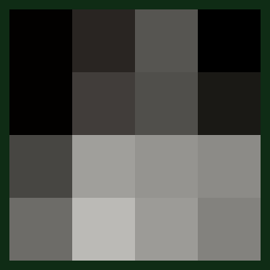
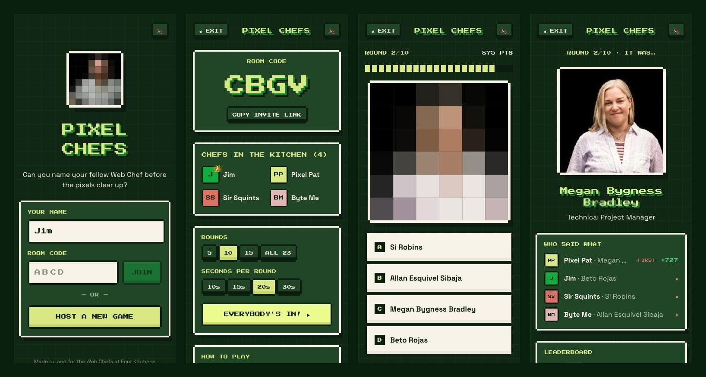

<div align="center">



# Pixel Chefs

**Who's behind the pixels?** A Jackbox-style multiplayer party game for my team at
[Four Kitchens](https://www.fourkitchens.com/team/). A coworker's headshot starts as
a chunky pixel blob and sharpens every couple of seconds, and everyone races to name them first.

[](https://github.com/nJim/pixel-chefs/actions/workflows/ci.yml)


[](LICENSE)

</div>



## Why

We're a distributed team across the US and Costa Rica, and a lot of us know each other
only from Zoom tiles. I wanted something for team meetings that's quick to join, works
on any phone, and is mostly an excuse to put names to faces. The idea draws on the
Jackbox room-code model. The look comes from the company's own pixel-art brand and palette.

## How it plays

1. **Host** a game and share the 4-letter room code or invite link. No accounts or installs.
2. Everyone **joins on their own device**. That matters on a video call: each player renders
   the photo locally, so screen-share lag can't tip off whoever's watching the fastest feed.
3. Each round, a Web Chef's photo **steps through 10 pixel stages** (4×4 → 6×6 → … → full photo).
4. **Pick one of four names.** Points drop the longer you wait, and a wrong guess locks you out for the round.
5. The **reveal** shows the full photo, who guessed what, and an animated leaderboard. After the
   last round there's a podium with superlatives (🦅 *Eagle Eye*, 👓 *Needs Glasses*).

| | Points |
| --- | --- |
| Correct answer | 1000 → 100, decaying linearly with time |
| First correct answer of the round | +250 ⚡ First Blood |
| Wrong or no answer | 0, locked out for the round |

## Interesting bits

**Live state without writing a socket layer.** The whole game is one live query
(`game(code, playerKey)`) on [Spacefast Zero](https://spacefast.com/docs/zero-runtime).
Every mutation (join, answer, next round) invalidates it, and every connected device re-renders.
There's no polling and no hand-rolled WebSocket protocol.

**The server is the clock.** Round start and end times are server timestamps. Each client
measures its offset from `/api/time` (best of 4 round trips, NTP-style), so countdowns and
pixel stages line up across devices. Scoring uses the server's receive time, so a fast phone
on slow Wi-Fi isn't penalized and a tampered client clock can't help.

**Other players' picks stay secret until reveal.** While a round is live, the query returns
only the options, who has locked in, and *your own* result. Everyone's picks and correctness
are added to the payload only after the round ends. (The photo itself has to reach the browser
to be pixelated, so someone poking around in dev tools could cheat. For a team game that
trade-off is fine. See *Ideas for later*.)

**Nobody owns the timer.** When time runs out, any client can call the idempotent `endRound`
mutation, and the server double-checks the deadline. A host who closes the laptop mid-round
doesn't freeze the game for everyone else. The round also ends early once everyone has locked in.

**Pixelation is two `drawImage` calls.** The photo is drawn into an N×N offscreen canvas,
where the browser averages each block, then scaled back up with `imageSmoothingEnabled = false`.
Stages snap instead of blurring smoothly, and faint grid lines on the chunky stages give it a
sprite-sheet feel. See [`client/PixelImage.tsx`](client/PixelImage.tsx).

**8-bit sound with no audio files.** Countdown blips, sharpening ticks, a correct-answer
arpeggio and a fanfare are all short square-wave sequences from the Web Audio API
([`client/sound.ts`](client/sound.ts)).

**One seat per tab.** A player is the platform's guest identity plus a per-tab key in
`sessionStorage`. Refreshing keeps your seat, and opening four tabs gives you four players,
which made multiplayer testing on one laptop easy.

**Pixel UI with no image assets.** Borders, buttons and panels use stacked `box-shadow`s
for stepped "pixel corners", and the timer bar is a CSS mask. The palette comes straight from the
Four Kitchens site's design tokens.

## Architecture

All game state lives on the server. Each client subscribes to a single live query and calls a few mutations:

1. **Lobby.** The host calls `createRoom` and players call `joinRoom`. Each call refreshes the `game` query on every connected device, so the player list updates live.
2. **Round start.** The host calls `startGame`. The server picks the chefs and writes a round with server-time `startsAt` and `endsAt`.
3. **During the round.** Each client counts down and steps through the pixel stages from those timestamps, adjusted by its measured clock offset. Nothing streams. Every device computes the same frame on its own.
4. **Answering.** `submitAnswer` is scored on the server's clock. Other players only learn *that* you've locked in, not what you picked.
5. **Round end.** When the last player answers, the server ends the round itself. If time runs out first, whichever client notices calls `endRound`, and the server checks the deadline before ending it.
6. **Reveal.** Once the round has ended, the `game` query includes everyone's picks and points. The host advances with `nextRound`, and the last round leads to the podium.

```
server/index.ts         Schema, the `game` live query, mutations, /api/time
shared/scoring.ts       Pure rules: points curve, pixel stages, palette, input cleaning
shared/team.ts          Generated roster (opaque id, name, title)
client/App.tsx          Hash routing (#/CODE) and per-tab player identity
client/{Home,Lobby,Round,Reveal,Podium}.tsx   Screens
client/PixelImage.tsx   Canvas pixelation
client/clock.ts         Server clock sync
client/chef-images.ts   Generated 320px headshots as data URIs
scripts/fetch-team.mjs  Scrapes the team page → roster + images
scripts/make-media.mjs  Renders docs/pixel-reveal.gif with the game's own stages
tests/                  Unit tests for the game rules (node:test)
```

## Running it

Requires Node 22.18+ and the [Spacefast CLI](https://spacefast.com/docs/cli)
(`npm i -g spacefast`).

```sh
npm install
npm run dev            # local Zero server with SQLite state
```

Open the private URL that `sf dev` prints. Each browser tab is a separate player.

```sh
npm run check          # strict typecheck + unit tests
npm run fetch-team     # refresh roster + headshots from fourkitchens.com/team
npm run make-media     # regenerate the README GIF
npm run deploy         # sf publish (Spaces are private by default)
```

### Making it your own

The game doesn't depend on Four Kitchens. Point `scripts/fetch-team.mjs` at your own team
page, or write `shared/team.ts` and `client/chef-images.ts` by hand, then swap the palette
in [`client/styles.ts`](client/styles.ts).

## Ideas for later

- Host "TV mode": a big shared screen for in-person play, with phones as controllers
- Harder rounds: name *and* title, or free-text answers with fuzzy matching
- Streaks and combo bonuses
- Keep the photo off the client until reveal by pixelating on the server

## License

Code is [MIT](LICENSE). Team names and headshots come from the public
[Four Kitchens team page](https://www.fourkitchens.com/team/) and belong to Four Kitchens
and the people pictured. The Four Kitchens name and brand are theirs too.
